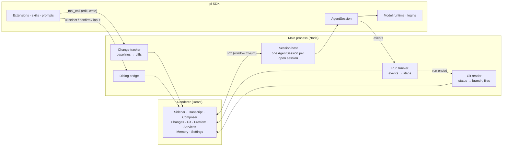

<div align="center">

[English](README.md) · [简体中文](README.zh-CN.md) · **日本語**

# Trivium

**コーディング、リサーチ、執筆のためのひとつのデスクトップワークスペース。pi エージェントで動きます。**

3 つの専用モードが、ひとつのウインドウ、pi のセッション、ログインを共有します。モードごとにツール、
拡張機能、モデルが分かれているので、コードを直すエージェントと出典を示すエージェントは別物です。

[](https://www.npmjs.com/package/@earendil-works/pi-coding-agent)
[](https://www.electronjs.org/)
[](https://react.dev/)
[](https://www.typescriptlang.org/)
[](#動作環境)
[](#ロードマップ)
[](LICENSE)
[](https://github.com/SkarnerV/Trivium/stargazers)

[機能](#機能) · [クイックスタート](#クイックスタート) · [しくみ](#しくみ) · [拡張機能](#拡張機能) · [ロードマップ](#ロードマップ) · [コントリビュート](#コントリビュート)


</div>

## なぜ Trivium か

ターミナルのエージェントは便利ですが、何が起きたのかを確かめたくなると途端に見づらくなります。Trivium はエージェントの作業を
見える場所に置きます。実行した各ステップとその所要時間、回答を待っている質問、そして残された正確な差分。
さらに、コーディング、リサーチ、執筆では必要な道具が違うので、何でもこなそうとするひとつのプロンプトではなく、
それぞれに専用のモードを用意しています。

中身は SDK で組み込んだ [pi](https://github.com/earendil-works/pi) です。セッションは普通の pi のセッションなので
pi CLI でも開けますし、pi の拡張機能、スキル、プロバイダーはすべてここで使えます。

## 機能

### 3 つのモード、ひとつのウインドウ

| | モード | 用途 | 初期設定 |
|---|---|---|---|
|  | **コード** | ソフトウェアを直す、作る | `read` `bash` `edit` `write` と、変更・Git・プレビュー・サービスを表示するパネル |
|  | **リサーチ** | 資料を読み、ノートを書く | シェルなし。`read` `write` `grep` `find` `ls` と `web_*` ツール。すべての主張に出典を示すよう指示 |
|  | **ライティング** | プロジェクト内の文書 | 編集ツール。あなたの文体を保ち、確認しやすい小さな編集をするよう指示 |

`⌘1` `⌘2` `⌘3` で切り替えます。セッションはバックグラウンドで動き続け、切り替えボタンの点でまだ作業中のモードがわかります。

### 答えだけでなく、作業そのものを見る

- **ステップは折りたたみも詳細表示も。** 「作業 6.4s · 8 ステップ · 1 件失敗」のように邪魔にならず、開けば読み込み、検索、編集、コマンドのひとつひとつを結果と所要時間つきで確認できます。
- **いま何をしているか。** 「作業中」の下の控えめな 1 行に現在のステップが表示され、コマンドなら最新の出力行が出ます。
- **サブエージェントもエージェントとして見える。** `pi-subagents` の呼び出しでは、誰に委任したか、各子エージェントが何をしているかを、並列なら 1 行ずつ表示します。開くとタスク、結果、モデル、トークン数がわかります。バックグラウンドの結果は独立した実行として届きます。
- **実行中に待機させる、指示を出す。** エージェントの作業中も入力できます。`↵` で実行後に送るメッセージを待機させ、`⌥↵` で実行中の処理に指示を出し、`esc` で停止します。
- **コンテキストがひと目でわかる。** 小さなリングがコンテキストウィンドウの使用量を示し、ホバーすると内訳と自動圧縮のタイミングが見られます。
- **返信のタイミング。** 返信にカーソルを合わせると、回答時刻、所要時間、最初のトークンまでの時間、毎秒のトークン数がわかります。
- **上限をわかりやすい言葉で。** プロバイダーの使用上限や残高が尽きたとき、Trivium は何が起きたか、いつリセットされるか、どこでチャージできるかを伝え、プロバイダーの元のメッセージもワンクリックで見られます。

### 会話

- **どのメッセージも編集、分岐、コピーできる。** 編集はメッセージをその場で開き、送信するとそこからやり直します。以前の返信は pi が別のブランチに残します。分岐はそのメッセージまでの会話を新しいセッションにコピーします。コピーはメッセージや返信の Markdown をそのまま取ります。
- **プロジェクトなしのチャット。** 「新しいセッション」で**プロジェクトなし**を選ぶと、フォルダのいらない会話ができます。チャットはサイドバーの「チャット」の下に並びます。
- **固定と整理。** プロジェクトやセッションを右クリックすると、先頭に固定する、新しいセッションを始める、メッセージを Markdown で書き出す、セッション ID をコピーする、削除する、が選べます。
- **モデルと思考の深さをひとつのボタンで。** メッセージ欄のモデルボタンを押すと、思考の深さのスライダーと検索できるモデル一覧のメニューが開きます。

<p align="center">
  
</p>

### 添付ファイル

クリップのアイコンからファイルを添付するか、メッセージ欄にドラッグするか、スクリーンショットを貼り付けます。画像は pi CLI と同じ方法で変換・縮小され、テキストファイルは `<file>` ブロックとして入ります。会話には添付したものが表示され、選んだモデルが画像を読めないときはメッセージ欄が警告します。

### プロジェクトの信頼

独自の `.pi` フォルダ（設定、拡張機能、スキル、プロンプト、MCP サーバー）を持つプロジェクトはコードを実行できます。Trivium は pi CLI と同じく、読み込む前に**信頼する**、**今回のみ**、**信頼しない**を確認します。選択は pi の `trust.json` に保存されるので CLI も覚えており、pi の `defaultProjectTrust` 設定も尊重されます。

### コマンドと MCP

- **`/` でコマンド。** 一覧には拡張機能のコマンド、プロンプトテンプレート、スキルに加え、Trivium の `/compact [instructions]` と `/name <title>` が出ます。`/mcp login <server>` のように候補を出すコマンドは引数も補完されます。
- **MCP サーバーは CLI と同じように動く。** Trivium は pi に組み込みの MCP、codemode、ツール検索の拡張機能を読み込むので、セッションの開始時に `~/.pi/agent/mcp.json` と信頼したプロジェクトの `.pi/mcp.json` のサーバーに接続します。`/mcp` で状態を確認できます。
- **コネクタのページで管理。** **設定 → コネクタ** では、コマンド、URL、または Claude、Cursor、VS Code から貼り付けた `mcpServers` の JSON からサーバーを追加し、編集、削除、オフにできます。各サーバーには、接続済みか、サインインが必要か（**サインイン**ボタンつき）、失敗しているかが表示され、ツールの一覧も見られます。ツールをエージェントに渡す方法は、サーバー全体またはツールごとに、コードモード、検索時、常に、オフから選べます。変更は pi のグローバルな `mcp.json` に保存されるので、pi CLI にも反映されます。

### 質問や承認は会話の中で

拡張機能が何かを尋ねると（`select`、`confirm`、`input`、`editor`）、質問がカードとして会話に表示されます。
`1`–`9`、`⌘↵`、`esc` で答えます。バックグラウンドのセッションがあなたを待っているときは通知が届きます。

### すべての変更をレビュー

コードモードのサイドパネルは、**パネルに表示**メニューから選んだ表示をひとつずつ見せます。

- **変更。** コードモードはエージェントが最初にファイルに触れる前の状態を記録するので、この表示ではセッション全体の正味の差分をファイルごとに確認できます。**変更を残す**で受け入れ、**元に戻す**ですべてのファイルを戻し、エージェントが作ったファイルやフォルダを削除します。どのファイルも、最初に変更された行を VS Code で開けます。
- **Git。** git リポジトリでは、ステージ済み、未ステージ、未追跡、競合のファイルをそれぞれ差分つきで表示します。実行の後、編集やコマンドの後、ウインドウにフォーカスが戻ったときに更新され、ポーリングはしません。
- **プレビュー。** プロジェクトのファイルをタブで開きます。HTML ページはサンドボックス化されたフレームで独自のスタイルや画像とともに表示され（許可するまでスクリプトはオフ、ネットワークはブロック）、Markdown、CSV の表、行番号つきのテキスト、画像も見られます。ディスク上でファイルが変わると再読み込みされます。ステップの目のアイコン、返信内のファイルパス、変更や Git の表示から開けます。
- **サービス。** 開発サーバー、ウォッチャー、データベースなど、`npm run dev &` のようにコマンドが起動したままのプロセス。それぞれのコマンド、プロセス、待ち受けポート、最新の出力が表示され、**停止**で本体とそれが起動したものをすべて終了します。アドレスはプレビューやブラウザで開けます。ヘッダーとサイドバーの緑の点は、そのセッションで何かが動いていることを示します。セッションをアンロードしてもサービスは動き続け、セッションを削除するか Trivium を終了すると停止します（終了前に確認します）。Trivium がクラッシュした場合は、次の起動時にまた表示されます。

ヘッダーにはセッションのブランチ、変更されたファイル数が表示され、プッシュやプルすべきコミットがあると点が付きます。
クリックすると文章での概要が出ます。上流ブランチと最後に取得した時刻、まだプッシュしていないコミットとリモートにあるコミット、
ステージ済みや変更済みの内容、そしてエージェントにプッシュを頼むボタン。

### ノートと変更履歴

- **リサーチは書いたノートを表示。** パネルが Markdown のノートを表も含めて文書としてレンダリングし、「出典」タブに引用したリンクをすべて並べます。**ライティングで開く**を押すと、同じプロジェクトでライティングのセッションが始まり、すぐにノートを手直しできます。
- **ライティングは編集を変更履歴として表示。** 文書の各変更がその場に表示されます。削除した文字には取り消し線、新しい文字には下線。変更はひとつずつ、またはまとめて承認・却下でき、却下すると元の文章がファイルに戻ります。

### メモリ

すべてのモードが、組み込みの [`@pify/memory`](https://www.npmjs.com/package/@pify/memory) でセッションをまたいで覚えます。
グローバルな `MEMORY.md`、プロジェクトごとの `.pi/memory/MEMORY.md`、そして日々のログ。認証情報は保存しません。
サイドバーから開く**メモリ**のページでは、エージェントがどこでも、各ワークスペースで、日々のログで覚えていることを確認できます。
項目の追加、編集、先頭への移動、削除ができ、元に戻すことも、「最近削除した項目」から復元することもできます。
メーターは各ファイルのうち新しいセッションに読み込まれる量を示します。ワークスペースごとに、
そのセッションでファイルを読み込むかどうかのスイッチがあり、このコンピュータで git から除外することもできます。

### 使用量

**設定 → 使用量** では、過去 7 日間、30 日間、全期間のすべてのセッションのトークン数と推定コストを集計します。
合計と前の期間からの変化、キャッシュから読んだ入力の割合、日ごとの棒グラフ、モード別・モデル別・使用量の多いセッション別の内訳。
過去 12 か月のカレンダーで活動日と連続日数がわかります。モデルの応答数にカーソルを合わせると、
最初のトークンまでの平均時間と出力速度が見られます。サブスクリプションでログインして使うモデルには、コストの代わりに「プラン」と表示されます。

### モードを自分好みに

<p align="center">
  
</p>

- **モードごとの拡張機能。** `~/.trivium/apps/<app>/extensions/` にファイルを置くか、どこからでも追加するか、pi がそのモードで読み込むものをオフにできます。「拡張機能を追加」ダイアログでは、モードごとにおすすめの pi パッケージが表示されます。
- **組み込みのパッケージ。** 各モードには削除できる pi パッケージが付属します。すべてのモードにメモリとサブエージェント、コードには `/plan` と権限システム、リサーチには文書の解析、ライティングには PDF の書き出し。
- **コードの権限レベル。** 何を先に確認するかを選べます。危険なコマンド（初期設定：`rm -rf`、`sudo`、`git push`、プロジェクト外のフォルダ）、すべてのコマンド、すべてのコマンドと編集、または何も確認しない。`.env` ファイルは常にブロックされます。
- **モードごとのモデル。** リサーチは速いモデルで、コードはいちばん強いモデルで。
- **ログインを内蔵。** pi 自身のログインフローでプロバイダーに接続します。API キー、ブラウザでのサインイン、デバイスコード。プロバイダーごとにロゴが表示されます。
- **カスタムエンドポイント。** Ollama、LM Studio、vLLM、プロキシ、または OpenAI、Anthropic、Gemini 互換のサーバーを追加できます。Trivium はモデルを、サーバーが示すコンテキストウィンドウ、出力上限、画像と思考への対応とあわせて取得し、モデルごとに自分で設定することもできます。組み込みのプロバイダーにも同じモデル一覧があり、プロキシのベース URL、モデルごとの上書き、ID によるモデルの追加に使えます。すべて pi の `models.json` に保存されるので、pi CLI でも同じモデルが使えます。
- **セッションは自動で管理。** アイドル状態のセッションはしばらくするとアンロードされ、開くとディスクから再読み込みされます。
- **あなたの言語で。** 画面は English、简体中文、日本語に対応しています。初期設定ではコンピュータの言語に合わせ、**設定 → 一般**で選ぶこともできます。

## クイックスタート

### 動作環境

- macOS（Apple Silicon または Intel）、または Windows x64
- 少なくとも 1 つのモデルプロバイダー。**設定 → モデルとログイン**、または pi CLI（`pi` を実行して `/login`）で接続します。
- コーディング用のツールにはシェルとプロジェクトのツールが必要です。Windows では Bash のために Git for Windows をインストールしてください。

### ダウンロード

最新版は [GitHub Releases](https://github.com/SkarnerV/Trivium/releases/latest) からダウンロードします。
macOS では `arm64`（Apple Silicon）または `x64`（Intel）の DMG を選び、Trivium を「アプリケーション」にドラッグします。
Windows では ZIP をダウンロードしてアーカイブ全体を一度展開し、展開したフォルダ内の `Trivium.exe` を実行します。
付属のファイルはまとめて置いておいてください。アプリにはランタイムが含まれています。
以前の自己展開型ポータブル EXE は v0.1.0 で引き続き入手できますが、起動が遅くなります。
これらのプレビュー版は署名されておらず、macOS 版は公証も受けていません。macOS が初回の起動をブロックした場合は、
**システム設定 → プライバシーとセキュリティ**で Trivium を許可してください。

### ソースから実行

ソースからのビルドには Node.js 22.19 以降が必要です。

```bash
git clone https://github.com/SkarnerV/Trivium.git
cd Trivium
npm install --ignore-scripts
node node_modules/electron/install.js
npm start
```

`npm install --ignore-scripts` は依存関係のインストールスクリプトを実行しません。2 つ目のコマンドで、バージョン固定の Electron ランタイムをダウンロードします。

Windows では、`npm start` が `dist/runtime/` に Trivium の実行ファイルアイコンと製品名を持つ専用の `Trivium.exe` ランタイムを作成してキャッシュします。
`node_modules` 内の Electron には手を加えません。Electron の既定の実行ファイルアイコンやタスクバーアイコンを避けるため、`electron .` ではなく `npm start` を使ってください。
この開発用ランタイムは署名されておらず、インストーラーでも署名済みのリリース版でもありません。起動時に Trivium はスタートメニューのショートカットを登録し、
Trivium が以前作ったショートカットとタスクバーの識別子を Electron の既定のブランドから移行します。ほかの Electron アプリのショートカットには触れません。
古いタスクバーのグループが終了できるよう、再起動の前に開いている Trivium のウインドウを閉じてください。

### キーボードショートカット

| キー | 操作 |
|---|---|
| `⌘1` `⌘2` `⌘3` | コード、リサーチ、ライティングに切り替え |
| `⌘N` | 新しいセッション |
| `⌘K` | すべてのモードでセッションを検索 |
| `⌘\` | サイドバーを折りたたむ／展開する |
| `⌘,` | 設定 |
| `↵` / `⌥↵` | 送信（実行中は待機させる）／実行中の処理に指示を出す |
| `/` | コマンドと候補。`tab` で補完 |
| `esc` | 実行を停止、質問を閉じる、ダイアログを閉じる |

Windows では `⌘` は `Ctrl`、`⌥` は `Alt` です。

## しくみ



- **pi はプロセス内で動く。** メインプロセスが pi SDK で `AgentSession` を作成します。CLI のサブプロセスも RPC のやり取りもありません。
- **各モードはエージェントのプロファイル：** ツールの許可リスト、システムプロンプトへの追記、拡張機能のフォルダで、セッションを読み込むときに適用されます。
- **データは pi が置く場所のまま。** セッションは `~/.pi/agent/sessions`、ログインは `~/.pi/agent/auth.json` にあります。Trivium は自分の設定を `~/.trivium` に追加するだけです。

| パス | 中身 |
|---|---|
| `~/.pi/agent/` | pi の設定、ログイン、モデル、セッション。pi CLI と共有 |
| `~/.trivium/apps/<app>/extensions/` | そのモードでだけ読み込む拡張機能 |
| `~/.trivium/settings.json` | 言語、文字サイズ、アイドル時のアンロード、通知、モードごとのモデルと拡張機能のスイッチ |
| `~/.trivium/session-apps.json` | 各セッションが属するモード。ほかから来たセッションはコードに表示 |
| `~/.trivium/changes/` | エージェントが変更する前のファイル内容。残すか元に戻すまで保持 |
| `~/.trivium/chats/` | 「プロジェクトなし」で始めたセッションの作業フォルダ |
| `~/.trivium/usage-cache.json` | 各セッションの使用量の合計。ファイルが変わったときだけ数え直す |
| `~/.pi/agent/memory/`、`.pi/memory/MEMORY.md` | `@pify/memory` が保存するグローバルとプロジェクトごとのメモリ |

## 拡張機能

どの [pi の拡張機能](https://github.com/earendil-works/pi/blob/main/packages/coding-agent/docs/extensions.md)
も Trivium で動きます。ひとつのモードだけで読み込むには、そのモードのフォルダに置きます。

```ts
// ~/.trivium/apps/research/extensions/cite-check.ts
import type { ExtensionAPI } from "@earendil-works/pi-coding-agent";

export default function (pi: ExtensionAPI) {
  pi.registerCommand("cite", {
    description: "Check the citations in the last answer",
    handler: async (_args, ctx) => {
      const ok = await ctx.ui.confirm("Check citations", "Fetch every cited URL?");
      if (ok) ctx.ui.notify("Checking citations…");
    },
  });
}
```

`ctx.ui` のダイアログは会話の中にカードとして表示され、`notify` はトーストを表示します。pi 自体にインストールした拡張機能
（`~/.pi/agent` 内、または pi パッケージ）は、そのモードの設定でオフにしない限り、すべてのモードで読み込まれます。

## 開発

```bash
npm run check   # type-check
npm start       # build and launch
npm run dev     # launch and rebuild on save
npm test        # run the test suite
npm run package -- --win --x64 --publish never # Windows ZIP
npm run package -- --mac --arm64 --publish never # macOS DMG (run on macOS)
```

パッケージは `release/` に出力されます。`v0.1.0` のようなバージョンタグをプッシュすると、Windows と 2 種類の Mac アーキテクチャでリリースのワークフローが動きます。
パッケージ化した各アプリを確認・起動してから、Windows の ZIP と 2 つの macOS の DMG をまとめて GitHub Releases に公開します。
パッケージ化したアプリがランナー上で 20 秒以内に準備できなければ、Windows の起動チェックは失敗します。

`npm run dev` は、レンダラーや preload のコードが変わるとウインドウを再読み込みし（選択中のセッションを開き直します）、
`styles.css` は再読み込みなしで適用し、メインプロセスのコードが変わるとアプリを再起動します。

UI の作業に本物のプロバイダーは不要です。`TRIVIUM_DEV_FAUX=1` でスクリプト化されたモデル `trivium-faux/scripted` が読み込まれ、
ファイルを読み、コマンドを実行し、質問し、編集し、テストを書いて説明する、というバグ修正の一部始終を再生します。
「server」を含むプロンプトでは、代わりにサービス表示用の小さな Web サーバーをバックグラウンドで起動します。
テストの実行は本物のデータから切り離してください。`TRIVIUM_HOME` はそのコピーのウインドウの状態も保持するので、
あなた自身の開いているセッションやレイアウトは変わりません。

```bash
PI_CODING_AGENT_DIR=/tmp/pi-dev TRIVIUM_HOME=/tmp/trivium-dev TRIVIUM_DEV_FAUX=1 npm start
```

この README のスクリーンショットは、そのスクリプト化されたモデルで撮ったものです。`TRIVIUM_EVAL` は読み込み後のページでスクリプトを実行し、
`TRIVIUM_CAPTURE=shot.png` はスクリーンショットを保存します。スクリーンショットはこの方法で撮っています。

```
src/
  main/       Electron main process: session host, run and change tracking, settings, logins
  preload/    The window.trivium bridge
  renderer/   React UI
  shared/     Types shared across the IPC boundary, and the translations
dev/          The scripted development model
```

画面の文字の翻訳は `src/shared/locales/` にあり、英語の原文をキーにしています。コードでは `t("English text")` で文字を表示し、
`npm test` がすべての文字に各言語の翻訳があるかを確認します。

## ロードマップ

- [x] ライブのステップ、指示、コンテキストリングを備えたコード、リサーチ、ライティングのモード
- [x] 会話内の拡張機能ダイアログとシステム通知
- [x] 残す・元に戻すができる変更パネル
- [x] 設定：ログイン、カスタムエンドポイント、既定とモードごとのモデル、モードごとの拡張機能
- [x] リサーチ：出典つきのノートプレビューパネル
- [x] ライティング：承認・却下できる変更履歴つきの文書パネル
- [x] すべてのモードのメモリと、それを確認するメモリのページ
- [x] トークン、コスト、返信速度を示す使用量のページ
- [x] MCP サーバー用のコネクタのページ
- [x] コード：Git 表示、ブランチの概要、ファイルのプレビュー
- [x] メッセージの編集・分岐・コピー、プロジェクトなしのチャット、プロジェクトとセッションの固定
- [x] 英語、簡体字中国語、日本語の画面
- [ ] npm から名前で拡張機能をインストール、`@coresmos` 配下の公式プラグイン
- [ ] ダークテーマ
- [ ] macOS、Windows、Linux 向けの署名済みビルド
- [ ] git のスナップショットで `bash` による変更を追跡

## コントリビュート

Trivium はまだ初期のプレビュー版で、Issue やプルリクエストを歓迎します。大きな変更の前には、
進め方をすり合わせるために Issue を立ててください。プルリクエストを送る前に `npm run check` を実行し、
UI の変更にはスクリーンショットを添えてください。スクリプト化されたモデルを使えば簡単に撮れます。

## ライセンス

[MIT](LICENSE) © SkarnerV。Trivium のために書いたプラグインや拡張機能のライセンスは自由に決められます。

## 謝辞

Trivium は Earendil Works の [pi](https://github.com/earendil-works/pi) の上に作られています。名前は trivium（三学）、
つまり古典的な学問の 3 つの基礎（文法、論理、修辞）に由来し、ここでは執筆、コード、リサーチにあたります。
