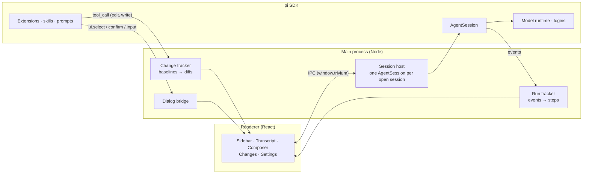

<div align="center">

# Trivium

**One desktop workspace for coding, research and writing, powered by the pi agent.**

Three focused apps share one window, your pi sessions and your logins. Each has its own tools,
extensions and model, so the agent fixing your code is not the one citing your sources.

[](https://www.npmjs.com/package/@earendil-works/pi-coding-agent)
[](https://www.electronjs.org/)
[](https://react.dev/)
[](https://www.typescriptlang.org/)
[](#requirements)
[](#roadmap)
[](https://github.com/SkarnerV/Trivium/stargazers)

[Features](#features) · [Quick start](#quick-start) · [How it works](#how-it-works) · [Extensions](#extensions) · [Roadmap](#roadmap) · [Contributing](#contributing)


</div>

## Why Trivium

Terminal agents are great until you want to see what happened. Trivium keeps the agent's work in
view: every step it took and how long it took, the question it is waiting on, the exact diff it
left behind. And because coding, research and writing need different tools, it gives each its own
app instead of one prompt that tries to do everything.

Under the hood it is [pi](https://github.com/earendil-works/pi), embedded through its SDK. Your
sessions are ordinary pi sessions, so you can open them in the pi CLI too, and every pi extension,
skill and provider works here.

## Features

### Three apps, one window

| | App | Built for | Default setup |
|---|---|---|---|
|  | **Code** | Fixing and building software | `read` `bash` `edit` `write`, plus a Changes panel |
|  | **Research** | Reading sources and writing notes | No shell; `read` `write` `grep` `find` `ls` and any `web_*` tools; told to cite every claim |
|  | **Write** | Documents in your project | Edit tools; told to keep your voice and make small, reviewable edits |

Switch with `⌘1` `⌘2` `⌘3`. Sessions keep running in the background; a dot on the switcher tells
you which app is still busy.

### See the work, not just the answer

- **Steps, folded or detailed.** "Worked for 6.4s · 8 steps" stays out of the way; open it to see each read, search, edit and command with its result and duration.
- **Live command output** while a bash step runs.
- **Steer mid-run.** Type while the agent works: `↵` steers the current run, `⌥↵` queues a follow-up, `esc` stops.
- **Context at a glance.** A small ring shows how full the context window is; hover it for the breakdown and when compaction kicks in.

<p align="center">
  
</p>

### Questions and approvals inline

When an extension asks something (`select`, `confirm`, `input`, `editor`), the question appears
in the conversation as a card. Answer with `1`–`9`, `⌘↵` or `esc`. If a session in the background
needs you, you get a notification.

### Review every change

The Code app records each file before the agent first touches it, so the **Changes** panel shows
the net diff of the whole session, per file. **Keep changes** accepts them. **Revert** puts every
file back and removes files and folders the agent created. Open any file in VS Code at the first
changed line.

### Make each app yours

<p align="center">
  
</p>

- **Per-app extensions.** Drop files into `~/.trivium/apps/<app>/extensions/`, add one from anywhere, or switch off anything pi would load for that app.
- **Per-app model.** Research on a fast model, Code on your strongest one.
- **Logins built in.** Connect providers with pi's own login flows: API keys, browser sign-in, device codes.
- **Sessions that manage themselves.** Idle sessions unload after a while and reload from disk when you open them.

## Quick start

### Requirements

- macOS (Windows and Linux builds are on the [roadmap](#roadmap))
- Node.js 22.19 or newer
- At least one model provider. Connect it in **Settings → Models and logins**, or with the pi CLI (`pi`, then `/login`).

### Run from source

```bash
git clone https://github.com/SkarnerV/Trivium.git
cd Trivium
npm install --ignore-scripts
node node_modules/electron/install.js
npm start
```

`npm install --ignore-scripts` skips dependency install scripts; the second command downloads the
pinned Electron runtime.

### Keyboard shortcuts

| Keys | Action |
|---|---|
| `⌘1` `⌘2` `⌘3` | Switch to Code, Research, Write |
| `⌘N` | New session |
| `⌘K` | Search sessions in every app |
| `⌘\` | Fold or unfold the sidebar |
| `⌘,` | Settings |
| `↵` / `⌥↵` | Send (steers while a run is going) / queue a follow-up |
| `esc` | Stop the run, dismiss a question, close a dialog |

## How it works



- **pi runs in-process.** The main process creates `AgentSession`s with the pi SDK, with no CLI subprocess and no RPC framing.
- **Each app is an agent profile:** a tool allowlist, an addition to the system prompt, and an extension folder, applied when a session loads.
- **Your data stays where pi keeps it.** Sessions live in `~/.pi/agent/sessions` and logins in `~/.pi/agent/auth.json`. Trivium adds only its own preferences in `~/.trivium`.

| Path | What it holds |
|---|---|
| `~/.pi/agent/` | pi's settings, logins, models and sessions, shared with the pi CLI |
| `~/.trivium/apps/<app>/extensions/` | Extensions loaded only for that app |
| `~/.trivium/settings.json` | Text size, idle unloading, notifications, per-app models and extension switches |
| `~/.trivium/session-apps.json` | Which app each session belongs to; sessions from elsewhere show under Code |
| `~/.trivium/changes/` | File contents from before the agent's changes, until you keep or revert |

## Extensions

Any [pi extension](https://github.com/earendil-works/pi/blob/main/packages/coding-agent/docs/extensions.md)
works in Trivium. To load one in a single app, put it in that app's folder:

```ts
// ~/.trivium/apps/research/extensions/cite-check.ts
import type { ExtensionAPI } from "@earendil-works/pi-coding-agent";

export default function (pi: ExtensionAPI) {
  pi.registerCommand("cite", {
    description: "Check the citations in the last answer",
    handler: async (_args, ctx) => {
      const ok = await ctx.ui.confirm("Check citations", "Fetch every cited URL?");
      if (ok) ctx.ui.notify("Checking citations…");
    },
  });
}
```

Dialogs from `ctx.ui` show up as cards in the conversation; `notify` shows a toast. Extensions you
install for pi itself (in `~/.pi/agent` or as pi packages) load in every app unless you switch
them off in that app's settings.

## Development

```bash
npm run check   # type-check
npm start       # build and launch
```

You don't need a real provider to work on the UI. `TRIVIUM_DEV_FAUX=1` loads a scripted model,
`trivium-faux/scripted`, that plays a whole bug fix: it reads a file, runs commands, asks a
question, edits, writes a test and explains. Keep test runs out of your real data:

```bash
PI_CODING_AGENT_DIR=/tmp/pi-dev TRIVIUM_HOME=/tmp/trivium-dev TRIVIUM_DEV_FAUX=1 npm start
```

The screenshots in this README come from that scripted model. `TRIVIUM_EVAL` runs a script in the
page after load and `TRIVIUM_CAPTURE=shot.png` saves a screenshot, which is how they were taken.

```
src/
  main/       Electron main process: session host, run and change tracking, settings, logins
  preload/    The window.trivium bridge
  renderer/   React UI
  shared/     Types shared across the IPC boundary
dev/          The scripted development model
```

## Roadmap

- [x] Code, Research and Write apps with live steps, steering and the context ring
- [x] Inline extension dialogs and system notifications
- [x] Changes panel with keep and revert
- [x] Settings: logins, default and per-app models, per-app extensions
- [ ] Research: note preview panel with sources
- [ ] Write: document panel with tracked changes to accept or reject
- [ ] Install extensions from npm by name, and first-party plugins under `@coresmos`
- [ ] Dark theme
- [ ] Signed builds for macOS, Windows and Linux
- [ ] Track changes made through `bash` with git snapshots

## Contributing

Trivium is an early preview, and issues and pull requests are welcome. Before a large change,
please open an issue so we can agree on the approach. Run `npm run check` before you send a pull
request, and include a screenshot for UI changes. The scripted model makes those easy to take.

## License

No license has been chosen yet. Until one is added, the code is all rights reserved.

## Acknowledgements

Trivium is built on [pi](https://github.com/earendil-works/pi) by Earendil Works. The name comes
from the trivium, the three classical arts of learning (grammar, logic and rhetoric), here
writing, code and research.
