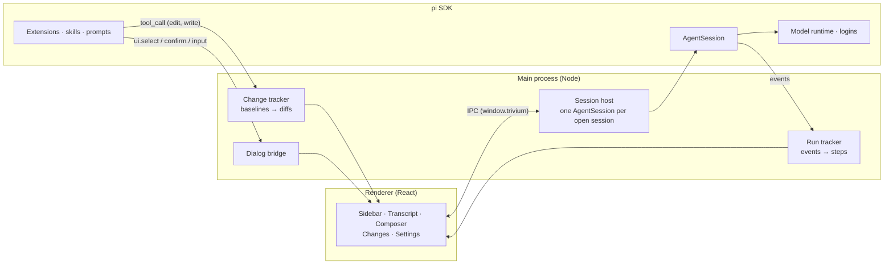

<div align="center">

# Trivium

**One desktop workspace for coding, research and writing, powered by the pi agent.**

Three focused modes share one window, your pi sessions and your logins. Each has its own tools,
extensions and model, so the agent fixing your code is not the one citing your sources.

[](https://www.npmjs.com/package/@earendil-works/pi-coding-agent)
[](https://www.electronjs.org/)
[](https://react.dev/)
[](https://www.typescriptlang.org/)
[](#requirements)
[](#roadmap)
[](LICENSE)
[](https://github.com/SkarnerV/Trivium/stargazers)

[Features](#features) · [Quick start](#quick-start) · [How it works](#how-it-works) · [Extensions](#extensions) · [Roadmap](#roadmap) · [Contributing](#contributing)


</div>

## Why Trivium

Terminal agents are great until you want to see what happened. Trivium keeps the agent's work in
view: every step it took and how long it took, the question it is waiting on, the exact diff it
left behind. And because coding, research and writing need different tools, it gives each its own
mode instead of one prompt that tries to do everything.

Under the hood it is [pi](https://github.com/earendil-works/pi), embedded through its SDK. Your
sessions are ordinary pi sessions, so you can open them in the pi CLI too, and every pi extension,
skill and provider works here.

## Features

### Three modes, one window

| | Mode | Built for | Default setup |
|---|---|---|---|
|  | **Code** | Fixing and building software | `read` `bash` `edit` `write`, plus a Changes panel |
|  | **Research** | Reading sources and writing notes | No shell; `read` `write` `grep` `find` `ls` and any `web_*` tools; told to cite every claim |
|  | **Write** | Documents in your project | Edit tools; told to keep your voice and make small, reviewable edits |

Switch with `⌘1` `⌘2` `⌘3`. Sessions keep running in the background; a dot on the switcher tells
you which mode is still busy.

### See the work, not just the answer

- **Steps, folded or detailed.** "Worked for 6.4s · 8 steps" stays out of the way; open it to see each read, search, edit and command with its result and duration.
- **Live command output** while a bash step runs.
- **Steer mid-run.** Type while the agent works: `↵` steers the current run, `⌥↵` queues a follow-up, `esc` stops.
- **Context at a glance.** A small ring shows how full the context window is; hover it for the breakdown and when compaction kicks in.

<p align="center">
  
</p>

### Attachments

Attach files with the paperclip, drag them onto the message box, or paste a screenshot. Images are converted and resized the way pi's CLI does it; text files go in as `<file>` blocks. The conversation shows what was attached, and the message box warns when the chosen model can't read images.

### Project trust

A project with its own `.pi` folder (settings, extensions, skills, prompts, MCP servers) can run code. Trivium asks before loading it, like pi's CLI: **Trust**, **Just this time** or **Don't trust**. Decisions go to pi's `trust.json`, so the CLI remembers them too, and pi's `defaultProjectTrust` setting is respected.

### Commands and MCP

- **Type `/` for commands.** The list shows extension commands, prompt templates and skills, plus Trivium's `/compact [instructions]` and `/name <title>`. Commands that offer suggestions, such as `/mcp login <server>`, complete their arguments too.
- **MCP servers work like in the CLI.** Trivium loads pi's built-in MCP, codemode and tool search extensions, so servers from `~/.pi/agent/mcp.json` and a trusted project's `.pi/mcp.json` connect when a session starts. `/mcp` shows their status.

### Questions and approvals inline

When an extension asks something (`select`, `confirm`, `input`, `editor`), the question appears
in the conversation as a card. Answer with `1`–`9`, `⌘↵` or `esc`. If a session in the background
needs you, you get a notification.

### Review every change

Code mode records each file before the agent first touches it, so the **Changes** panel shows
the net diff of the whole session, per file. **Keep changes** accepts them. **Revert** puts every
file back and removes files and folders the agent created. Open any file in VS Code at the first
changed line.

### Notes and tracked changes

- **Research shows the note it writes.** A panel renders the Markdown note as a document, tables included, and a Sources tab lists every link it cites. **Open in Write** starts a Write session in the same project, ready to revise the note.
- **Write shows its edits as tracked changes.** The document appears with each change in place: deleted text struck through, new text underlined. Accept or reject each change, or all at once. Rejecting puts your original text back in the file.

### Make each mode yours

<p align="center">
  
</p>

- **Per-mode extensions.** Drop files into `~/.trivium/apps/<app>/extensions/`, add one from anywhere, or switch off anything pi would load for that mode.
- **Per-mode model.** Research on a fast model, Code on your strongest one.
- **Logins built in.** Connect providers with pi's own login flows: API keys, browser sign-in, device codes.
- **Custom endpoints.** Add Ollama, LM Studio, vLLM, a proxy or any OpenAI, Anthropic or Gemini-compatible server. Trivium fetches its models with their context window, output limit, image and thinking support where the server says, and you can set each one yourself. They go to pi's `models.json`, so the pi CLI offers them too.
- **Sessions that manage themselves.** Idle sessions unload after a while and reload from disk when you open them.

## Quick start

### Requirements

- macOS (Apple Silicon or Intel), or Windows x64
- At least one model provider. Connect it in **Settings → Models and logins**, or with the pi CLI (`pi`, then `/login`).
- Coding tools need a shell and your project's tools. On Windows, install Git for Windows for Bash.

### Download

Download the latest build from [GitHub Releases](https://github.com/SkarnerV/Trivium/releases/latest).
On macOS, choose the `arm64` (Apple Silicon) or `x64` (Intel) DMG and drag Trivium to Applications.
On Windows, download the ZIP, extract the whole archive once, and run `Trivium.exe` inside
the extracted folder. Keep its accompanying files together. The app includes its runtime.
The older self-extracting portable EXE remains available in v0.1.0, but starts more slowly.
These preview builds are unsigned; macOS builds are not notarized. If macOS blocks the first
launch, allow Trivium in **System Settings → Privacy & Security**.

### Run from source

Building from source requires Node.js 22.19 or newer.

```bash
git clone https://github.com/SkarnerV/Trivium.git
cd Trivium
npm install --ignore-scripts
node node_modules/electron/install.js
npm start
```

`npm install --ignore-scripts` skips dependency install scripts; the second command downloads the
pinned Electron runtime.

On Windows, `npm start` creates and caches a private `Trivium.exe` runtime under
`dist/runtime/`, with Trivium's executable icon and product name. It does not modify the
Electron installation in `node_modules`. Use `npm start` rather than `electron .` to avoid
Electron's default executable/taskbar icon. This development runtime is unsigned; it is not
an installer or a signed release build. On startup, Trivium registers its Start Menu shortcut
and migrates old Trivium-owned shortcuts and taskbar identity away from the default Electron
branding. Other Electron applications' shortcuts are left untouched. Close existing Trivium
windows before restarting so the old taskbar group can exit.

### Keyboard shortcuts

| Keys | Action |
|---|---|
| `⌘1` `⌘2` `⌘3` | Switch to Code, Research, Write |
| `⌘N` | New session |
| `⌘K` | Search sessions in every mode |
| `⌘\` | Fold or unfold the sidebar |
| `⌘,` | Settings |
| `↵` / `⌥↵` | Send (steers while a run is going) / queue a follow-up |
| `/` | Commands, with suggestions; `tab` completes |
| `esc` | Stop the run, dismiss a question, close a dialog |

## How it works



- **pi runs in-process.** The main process creates `AgentSession`s with the pi SDK, with no CLI subprocess and no RPC framing.
- **Each mode is an agent profile:** a tool allowlist, an addition to the system prompt, and an extension folder, applied when a session loads.
- **Your data stays where pi keeps it.** Sessions live in `~/.pi/agent/sessions` and logins in `~/.pi/agent/auth.json`. Trivium adds only its own preferences in `~/.trivium`.

| Path | What it holds |
|---|---|
| `~/.pi/agent/` | pi's settings, logins, models and sessions, shared with the pi CLI |
| `~/.trivium/apps/<app>/extensions/` | Extensions loaded only for that mode |
| `~/.trivium/settings.json` | Text size, idle unloading, notifications, per-mode models and extension switches |
| `~/.trivium/session-apps.json` | Which mode each session belongs to; sessions from elsewhere show under Code |
| `~/.trivium/changes/` | File contents from before the agent's changes, until you keep or revert |

## Extensions

Any [pi extension](https://github.com/earendil-works/pi/blob/main/packages/coding-agent/docs/extensions.md)
works in Trivium. To load one in a single mode, put it in that mode's folder:

```ts
// ~/.trivium/apps/research/extensions/cite-check.ts
import type { ExtensionAPI } from "@earendil-works/pi-coding-agent";

export default function (pi: ExtensionAPI) {
  pi.registerCommand("cite", {
    description: "Check the citations in the last answer",
    handler: async (_args, ctx) => {
      const ok = await ctx.ui.confirm("Check citations", "Fetch every cited URL?");
      if (ok) ctx.ui.notify("Checking citations…");
    },
  });
}
```

Dialogs from `ctx.ui` show up as cards in the conversation; `notify` shows a toast. Extensions you
install for pi itself (in `~/.pi/agent` or as pi packages) load in every mode unless you switch
them off in that mode's settings.

## Development

```bash
npm run check   # type-check
npm start       # build and launch
npm run dev     # launch and rebuild on save
npm test        # run the test suite
npm run package -- --win --x64 --publish never # Windows ZIP
npm run package -- --mac --arm64 --publish never # macOS DMG (run on macOS)
```

Packages are written to `release/`. Pushing a version tag such as `v0.1.0` runs the release
workflow on Windows and both Mac architectures. It checks and launches each packaged app,
then publishes the Windows ZIP and two macOS DMGs together on GitHub Releases. Windows
startup checks fail if the packaged app does not become ready within 20 seconds on the runner.

`npm run dev` reloads the window when renderer or preload code changes (the selected session
reopens), applies `styles.css` without a reload, and restarts the app when main-process code
changes.

You don't need a real provider to work on the UI. `TRIVIUM_DEV_FAUX=1` loads a scripted model,
`trivium-faux/scripted`, that plays a whole bug fix: it reads a file, runs commands, asks a
question, edits, writes a test and explains. Keep test runs out of your real data; `TRIVIUM_HOME`
also holds that copy's window state, so it doesn't change the open session or layout of your own:

```bash
PI_CODING_AGENT_DIR=/tmp/pi-dev TRIVIUM_HOME=/tmp/trivium-dev TRIVIUM_DEV_FAUX=1 npm start
```

The screenshots in this README come from that scripted model. `TRIVIUM_EVAL` runs a script in the
page after load and `TRIVIUM_CAPTURE=shot.png` saves a screenshot, which is how they were taken.

```
src/
  main/       Electron main process: session host, run and change tracking, settings, logins
  preload/    The window.trivium bridge
  renderer/   React UI
  shared/     Types shared across the IPC boundary
dev/          The scripted development model
```

## Roadmap

- [x] Code, Research and Write modes with live steps, steering and the context ring
- [x] Inline extension dialogs and system notifications
- [x] Changes panel with keep and revert
- [x] Settings: logins, custom endpoints, default and per-mode models, per-mode extensions
- [x] Research: note preview panel with sources
- [x] Write: document panel with tracked changes to accept or reject
- [ ] Install extensions from npm by name, and first-party plugins under `@coresmos`
- [ ] Dark theme
- [ ] Signed builds for macOS, Windows and Linux
- [ ] Track changes made through `bash` with git snapshots

## Contributing

Trivium is an early preview, and issues and pull requests are welcome. Before a large change,
please open an issue so we can agree on the approach. Run `npm run check` before you send a pull
request, and include a screenshot for UI changes. The scripted model makes those easy to take.

## License

[MIT](LICENSE) © SkarnerV. Plugins and extensions you write for Trivium are yours to license as you like.

## Acknowledgements

Trivium is built on [pi](https://github.com/earendil-works/pi) by Earendil Works. The name comes
from the trivium, the three classical arts of learning (grammar, logic and rhetoric), here
writing, code and research.
