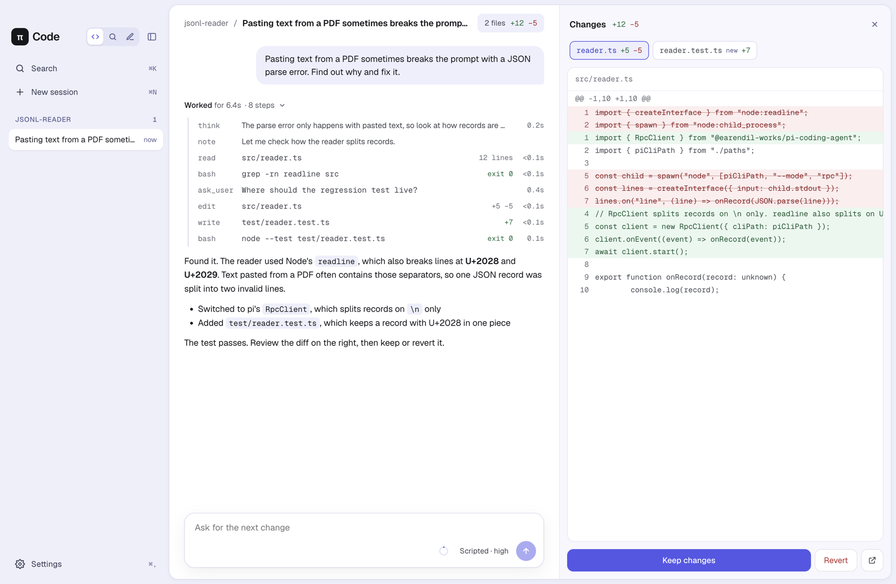
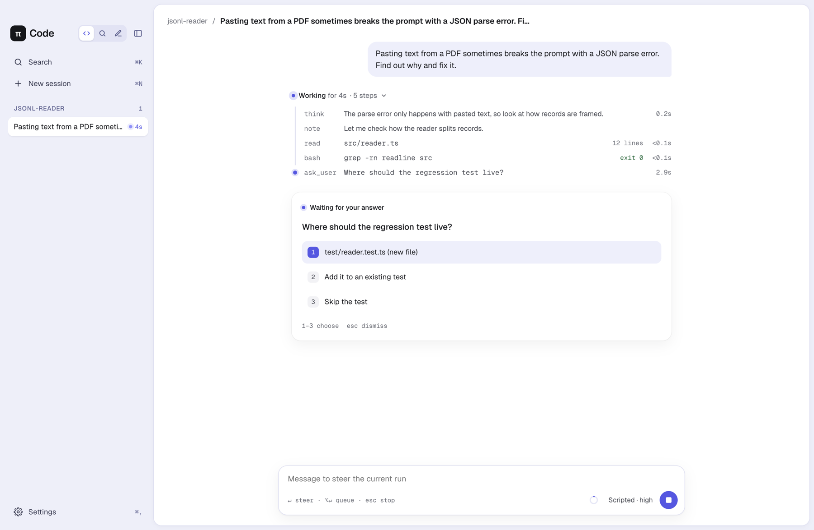
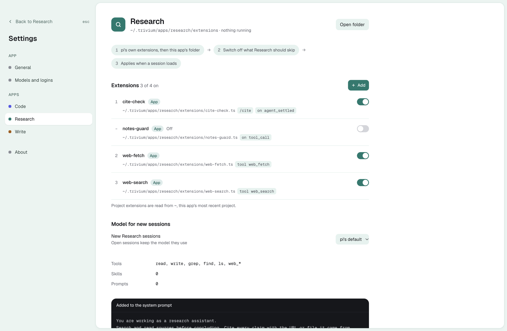
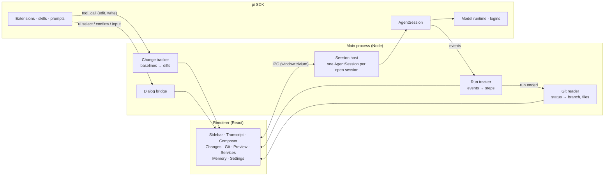

<div align="center">

[English](README.md) · **简体中文** · [日本語](README.ja.md)

# Trivium

**一个用于编程、研究和写作的桌面工作区，由 pi Agent 驱动。**

三个专注的模式共用一个窗口、你的 pi 会话和登录信息。每个模式都有自己的工具、扩展和模型，
所以修复代码的 Agent 和为你引用资料的 Agent 并不是同一个。

[](https://www.npmjs.com/package/@earendil-works/pi-coding-agent)
[](https://www.electronjs.org/)
[](https://react.dev/)
[](https://www.typescriptlang.org/)
[](#系统要求)
[](#路线图)
[](LICENSE)
[](https://github.com/SkarnerV/Trivium/stargazers)

[功能](#功能) · [快速开始](#快速开始) · [工作原理](#工作原理) · [扩展](#扩展) · [路线图](#路线图) · [参与贡献](#参与贡献)



</div>

## 为什么选择 Trivium

终端里的 Agent 很好用，直到你想看清它到底做了什么。Trivium 让 Agent 的工作始终可见：它执行的每一步、
每一步花了多久、它正在等待你回答的问题，以及它留下的精确差异。编程、研究和写作需要不同的工具，
所以 Trivium 为每一种工作提供独立的模式，而不是用一个提示去包揽一切。

底层是通过 SDK 嵌入的 [pi](https://github.com/earendil-works/pi)。你的会话就是普通的 pi 会话，
也可以在 pi CLI 中打开；所有 pi 扩展、技能和提供商在这里都能使用。

## 功能

### 三个模式，一个窗口

| | 模式 | 适用场景 | 默认配置 |
|---|---|---|---|
|  | **代码** | 修复和构建软件 | `read` `bash` `edit` `write`，以及包含更改、Git、预览和服务的侧边面板 |
|  | **研究** | 阅读资料、撰写笔记 | 不使用 shell；`read` `write` `grep` `find` `ls` 以及任何 `web_*` 工具；要求为每个论点注明出处 |
|  | **写作** | 项目中的文档 | 编辑类工具；要求保留你的文风，并以小而可审阅的步骤修改 |

用 `⌘1` `⌘2` `⌘3` 切换。会话会在后台继续运行；切换器上的圆点会告诉你哪个模式仍在忙碌。

### 看到工作过程，而不只是答案

- **步骤可折叠也可展开。** “已完成 用时 6.4s · 8 个步骤 · 1 个失败”默认不打扰你；展开即可看到每次读取、搜索、编辑和命令，以及它们的结果和耗时。
- **正在做什么。** “工作中”下方有一行低调的文字，写明当前步骤，命令则显示其最新一行输出。
- **子 Agent 像真正的 Agent 一样工作。** `pi-subagents` 调用会显示委派给了谁、每个子 Agent 在做什么，并行时每个子 Agent 一行；展开后可以看到任务、结果、模型和 token。后台结果会作为一次独立的运行送达。
- **运行中排队或引导。** Agent 工作时也可以输入：`↵` 将后续消息排队到本次运行之后，`⌥↵` 引导当前运行，`esc` 停止。
- **上下文一目了然。** 一个小圆环显示上下文窗口用了多少；悬停可查看明细以及何时会自动压缩。
- **回复耗时。** 指向一条回复，即可看到回答时间、总耗时、首个 token 用时和每秒 token 数。
- **用平实的语言说明限额。** 当提供商的用量上限或余额用尽时，Trivium 会说明发生了什么、何时重置、去哪里充值，提供商的原始消息一键可见。

### 对话

- **编辑、分叉或复制任意消息。** 编辑会就地打开一条消息，发送后从这里重新开始；pi 会把旧的回复保留在单独的分支上。分叉会把对话截至某条消息的内容复制到一个新会话中。复制会按原样复制消息或回复的 Markdown。
- **无项目的聊天。** 在“新会话”中选择**无项目**，即可开始不需要文件夹的对话。这些聊天位于侧边栏的“聊天”下。
- **置顶与整理。** 右键点击项目或会话，可以将其置顶、新建会话、将消息导出为 Markdown、复制会话 ID 或删除。
- **一个按钮管理模型和思考强度。** 消息框中的模型按钮会打开一个菜单，用滑块调节思考强度，并提供可搜索的模型列表。

<p align="center">
  
</p>

### 附件

点击回形针附加文件、将文件拖到消息框，或直接粘贴截图。图片的转换和缩放方式与 pi CLI 相同；文本文件以 `<file>` 块的形式加入。对话中会显示附加了什么；当所选模型无法读取图片时，消息框会给出提示。

### 项目信任

带有自己 `.pi` 文件夹（设置、扩展、技能、提示、MCP 服务器）的项目可以运行代码。Trivium 会像 pi CLI 一样在加载前询问：**信任**、**仅此一次**或**不信任**。选择会写入 pi 的 `trust.json`，pi CLI 也会记住；pi 的 `defaultProjectTrust` 设置同样有效。

### 命令与 MCP

- **输入 `/` 使用命令。** 列表中有扩展命令、提示模板和技能，以及 Trivium 的 `/compact [instructions]` 和 `/name <title>`。提供建议的命令（如 `/mcp login <server>`）也会补全参数。
- **MCP 服务器的用法与 CLI 相同。** Trivium 会加载 pi 内置的 MCP、codemode 和工具搜索扩展，因此会话启动时会连接 `~/.pi/agent/mcp.json` 以及已信任项目的 `.pi/mcp.json` 中的服务器。`/mcp` 可查看它们的状态。
- **用连接器页面管理它们。** **设置 → 连接器** 可以通过命令、URL 或从 Claude、Cursor、VS Code 粘贴的 `mcpServers` JSON 添加服务器，也可以编辑、移除或关闭它们。每个服务器都会显示是否已连接、是否需要登录（带**登录**按钮）或是否出错，并列出其工具。你可以为整个服务器或单个工具选择工具提供给 Agent 的方式：代码模式、按需搜索、始终或关闭。更改会写入 pi 的全局 `mcp.json`，pi CLI 也能看到。

### 在对话中直接回答问题和审批

当扩展提出问题（`select`、`confirm`、`input`、`editor`）时，问题会以卡片形式出现在对话中。
用 `1`–`9`、`⌘↵` 或 `esc` 回答。如果后台的某个会话需要你，你会收到通知。

### 审阅每一处更改

代码模式的侧边面板一次显示一个视图，可在其**在面板中显示**菜单中选择。

- **更改。** 代码模式会在 Agent 首次改动某个文件之前记录它，因此这个视图按文件显示整个会话的净差异。**保留更改**会接受这些更改。**还原**会恢复所有文件，并删除 Agent 创建的文件和文件夹。任何文件都可以在 VS Code 中打开并定位到第一处更改。
- **Git。** 在 git 仓库中，列出已暂存、未暂存、未跟踪和有冲突的文件，每个都附带差异。它会在运行结束、编辑或命令之后以及窗口重新获得焦点时刷新，无需轮询。
- **预览。** 以标签页打开项目文件：HTML 页面在沙盒框架中显示，带有自己的样式和图片（在你允许之前脚本关闭，网络被阻止），还支持 Markdown、CSV 表格、带行号的文本和图片。文件在磁盘上变化时会自动重新加载。可以从步骤上的眼睛图标、回复中的文件路径，或更改和 Git 视图中打开。
- **服务。** 开发服务器、监视进程、数据库，以及命令留下的任何其他进程，例如 `npm run dev &`。每个服务都会显示其命令、进程、监听的端口和最新输出，并提供**停止**按钮，停止它以及它启动的所有进程。可以在预览或浏览器中打开它的地址。标题栏和侧边栏中的绿点表示某个会话有服务在运行。会话被卸载时服务继续运行，会话被删除或 Trivium 退出时服务会停止（退出前会询问）。如果 Trivium 崩溃，下次启动时它们会再次显示。

标题栏会显示会话所在的分支、更改了多少文件，并在有提交需要推送或拉取时显示一个圆点。点击它可以看到文字概览：
上游分支及其最近一次获取时间、尚未推送的提交和远程有而本地没有的提交、已暂存或已更改的内容，以及一个让 Agent 推送的按钮。

### 笔记与修订

- **研究模式会显示它写的笔记。** 面板会将 Markdown 笔记渲染为文档（包括表格），“来源”标签页列出它引用的每个链接。**在写作中打开**会在同一项目中启动一个写作会话，随时可以修改这篇笔记。
- **写作模式以修订的形式显示其编辑。** 文档中的每处更改都就地呈现：删除的文字带删除线，新文字带下划线。可以逐一或全部接受或拒绝。拒绝会把你的原文写回文件。

### 记忆

每个模式都通过内置的 [`@pify/memory`](https://www.npmjs.com/package/@pify/memory) 跨会话记住内容：
一个全局的 `MEMORY.md`、每个项目一个 `.pi/memory/MEMORY.md`，以及每日日志。它拒绝保存凭据。
从侧边栏打开的**记忆**页面会显示 Agent 在所有位置、各个工作区以及每日日志中记住的内容。可以添加、编辑、
移到顶部或删除条目，支持撤销，并有“最近删除”列表。一个计量条显示每个文件有多少内容会加载到新会话中。
每个工作区都有一个开关，决定其会话是否加载该文件，并且可以在这台电脑上将它排除在 git 之外。

### 用量

**设置 → 用量** 汇总过去 7 天、30 天或全部时间内所有会话的 token 和预估费用：总量及与上一周期相比的变化、
从缓存读取的输入占比、每天的柱形图，以及按模式、按模型和用量最大的会话的明细。一个过去 12 个月的日历会显示你的活跃日和连续天数。
指向某个模型的响应次数，可查看其平均首个 token 用时和输出速度。通过订阅登录使用的模型显示“订阅”而不是费用。

### 让每个模式为你所用

<p align="center">
  
</p>

- **按模式配置扩展。** 将文件放入 `~/.trivium/apps/<app>/extensions/`，从任意位置添加一个，或关闭 pi 会为该模式加载的任何扩展。“添加扩展”对话框会为每个模式推荐 pi 包。
- **内置的包。** 每个模式都自带可移除的 pi 包：所有模式都有记忆和子 Agent，代码模式另有 `/plan` 和权限系统，研究模式有文档解析，写作模式有 PDF 导出。
- **代码模式的权限级别。** 选择哪些操作需要先询问：危险命令（默认：`rm -rf`、`sudo`、`git push` 以及项目外的文件夹）、每条命令、每条命令和每次编辑，或都不询问。`.env` 文件始终被阻止。
- **按模式选择模型。** 研究用快速模型，代码用你最强的模型。
- **内置登录。** 使用 pi 自己的登录流程连接提供商：API 密钥、浏览器登录、设备码。每个提供商都会显示其标志。
- **自定义端点。** 添加 Ollama、LM Studio、vLLM、代理，或任何兼容 OpenAI、Anthropic 或 Gemini 的服务器。Trivium 会获取其模型，以及服务器提供的上下文窗口、输出上限、图片和思考支持信息，你也可以逐个设置。内置提供商也有同样的模型列表，可用于代理 Base URL、按模型覆盖设置或按 ID 添加模型。所有设置都写入 pi 的 `models.json`，pi CLI 也会提供这些模型。
- **会话自我管理。** 闲置的会话会在一段时间后卸载，打开时再从磁盘重新加载。
- **你的语言。** 界面提供 English、简体中文和日本語，默认跟随电脑的语言，也可以在**设置 → 通用**中选择。

## 快速开始

### 系统要求

- macOS（Apple Silicon 或 Intel），或 Windows x64
- 至少一个模型提供商。可在**设置 → 模型与登录**中连接，或使用 pi CLI（运行 `pi`，然后输入 `/login`）。
- 编程工具需要 shell 和项目自身的工具链。在 Windows 上，请安装 Git for Windows 以获得 Bash。

### 下载

从 [GitHub Releases](https://github.com/SkarnerV/Trivium/releases/latest) 下载最新版本。
在 macOS 上，选择 `arm64`（Apple Silicon）或 `x64`（Intel）的 DMG，并将 Trivium 拖到“应用程序”文件夹。
在 Windows 上，下载 ZIP，一次性解压整个压缩包，然后运行解压文件夹中的 `Trivium.exe`。
请将随附的文件放在一起。应用已包含其运行时。较早的自解压便携版 EXE 仍可在 v0.1.0 中获取，但启动较慢。
这些预览版本未签名；macOS 版本未经公证。如果 macOS 阻止首次启动，请在**系统设置 → 隐私与安全性**中允许 Trivium。

### 从源代码运行

从源代码构建需要 Node.js 22.19 或更高版本。

```bash
git clone https://github.com/SkarnerV/Trivium.git
cd Trivium
npm install --ignore-scripts
node node_modules/electron/install.js
npm start
```

`npm install --ignore-scripts` 会跳过依赖的安装脚本；第二条命令会下载固定版本的 Electron 运行时。

在 Windows 上，`npm start` 会在 `dist/runtime/` 下创建并缓存一个私有的 `Trivium.exe` 运行时，带有 Trivium 的可执行文件图标和产品名称。
它不会修改 `node_modules` 中的 Electron。请使用 `npm start` 而不是 `electron .`，以避免显示 Electron 默认的可执行文件和任务栏图标。
这个开发运行时未签名；它不是安装程序，也不是签名的发布版本。启动时，Trivium 会注册其开始菜单快捷方式，
并将旧的、属于 Trivium 的快捷方式和任务栏标识从默认的 Electron 品牌迁移过来。其他 Electron 应用的快捷方式不受影响。
重启前请关闭现有的 Trivium 窗口，以便旧的任务栏分组能够退出。

### 键盘快捷键

| 按键 | 操作 |
|---|---|
| `⌘1` `⌘2` `⌘3` | 切换到代码、研究、写作 |
| `⌘N` | 新会话 |
| `⌘K` | 在所有模式中搜索会话 |
| `⌘\` | 折叠或展开侧边栏 |
| `⌘,` | 设置 |
| `↵` / `⌥↵` | 发送（运行进行中时排队）/ 引导当前运行 |
| `/` | 命令及建议；`tab` 补全 |
| `esc` | 停止运行、忽略问题、关闭对话框 |

在 Windows 上，`⌘` 对应 `Ctrl`，`⌥` 对应 `Alt`。

## 工作原理



- **pi 在进程内运行。** 主进程使用 pi SDK 创建 `AgentSession`，没有 CLI 子进程，也没有 RPC 封装。
- **每个模式都是一个 Agent 配置：** 一份工具白名单、一段追加到系统提示的内容，以及一个扩展文件夹，在会话加载时生效。
- **你的数据留在 pi 存放它的地方。** 会话位于 `~/.pi/agent/sessions`，登录信息位于 `~/.pi/agent/auth.json`。Trivium 只在 `~/.trivium` 中添加自己的偏好设置。

| 路径 | 内容 |
|---|---|
| `~/.pi/agent/` | pi 的设置、登录信息、模型和会话，与 pi CLI 共用 |
| `~/.trivium/apps/<app>/extensions/` | 仅为该模式加载的扩展 |
| `~/.trivium/settings.json` | 语言、文字大小、闲置卸载、通知、按模式的模型和扩展开关 |
| `~/.trivium/session-apps.json` | 每个会话所属的模式；来自其他地方的会话显示在代码模式下 |
| `~/.trivium/changes/` | Agent 更改之前的文件内容，直到你保留或还原 |
| `~/.trivium/chats/` | 以“无项目”启动的会话的工作文件夹 |
| `~/.trivium/usage-cache.json` | 每个会话的用量合计，只有在其文件变化时才重新统计 |
| `~/.pi/agent/memory/`、`.pi/memory/MEMORY.md` | 由 `@pify/memory` 保存的全局记忆和项目记忆 |

## 扩展

任何 [pi 扩展](https://github.com/earendil-works/pi/blob/main/packages/coding-agent/docs/extensions.md)
都能在 Trivium 中使用。如果只想在某一个模式中加载，把它放进该模式的文件夹：

```ts
// ~/.trivium/apps/research/extensions/cite-check.ts
import type { ExtensionAPI } from "@earendil-works/pi-coding-agent";

export default function (pi: ExtensionAPI) {
  pi.registerCommand("cite", {
    description: "Check the citations in the last answer",
    handler: async (_args, ctx) => {
      const ok = await ctx.ui.confirm("Check citations", "Fetch every cited URL?");
      if (ok) ctx.ui.notify("Checking citations…");
    },
  });
}
```

来自 `ctx.ui` 的对话框会以卡片形式出现在对话中；`notify` 会显示一条提示。为 pi 本身安装的扩展
（位于 `~/.pi/agent` 或以 pi 包形式安装）会在每个模式中加载，除非你在该模式的设置中将其关闭。

## 开发

```bash
npm run check   # type-check
npm start       # build and launch
npm run dev     # launch and rebuild on save
npm test        # run the test suite
npm run package -- --win --x64 --publish never # Windows ZIP
npm run package -- --mac --arm64 --publish never # macOS DMG (run on macOS)
```

打包产物会写入 `release/`。推送 `v0.1.0` 这样的版本标签会在 Windows 和两种 Mac 架构上运行发布工作流。
它会检查并启动每个打包好的应用，然后将 Windows ZIP 和两个 macOS DMG 一起发布到 GitHub Releases。
如果打包好的应用在运行器上 20 秒内没有就绪，Windows 的启动检查会失败。

`npm run dev` 会在渲染进程或 preload 代码变化时重新加载窗口（并重新打开所选会话），无需重新加载即可应用 `styles.css`，
并在主进程代码变化时重启应用。

开发 UI 不需要真实的提供商。`TRIVIUM_DEV_FAUX=1` 会加载一个脚本化的模型 `trivium-faux/scripted`，它会完整演示一次 bug 修复：
读取文件、运行命令、提问、编辑、编写测试并解释。提到“server”的提示则会在后台启动一个小型 Web 服务器，用于服务视图。
请将测试运行与真实数据隔离；`TRIVIUM_HOME` 也会保存这份副本的窗口状态，因此不会改变你自己的已打开会话或布局：

```bash
PI_CODING_AGENT_DIR=/tmp/pi-dev TRIVIUM_HOME=/tmp/trivium-dev TRIVIUM_DEV_FAUX=1 npm start
```

本 README 中的截图都来自这个脚本化模型。`TRIVIUM_EVAL` 会在页面加载后运行一段脚本，`TRIVIUM_CAPTURE=shot.png` 会保存截图，截图就是这样拍的。

```
src/
  main/       Electron main process: session host, run and change tracking, settings, logins
  preload/    The window.trivium bridge
  renderer/   React UI
  shared/     Types shared across the IPC boundary, and the translations
dev/          The scripted development model
```

界面文字的翻译位于 `src/shared/locales/`，以英文原文为键。代码中用 `t("English text")` 显示文字；
`npm test` 会检查每段文字在各语言中都有翻译。

## 路线图

- [x] 代码、研究和写作模式，带实时步骤、引导和上下文圆环
- [x] 对话内的扩展对话框和系统通知
- [x] 可保留或还原的更改面板
- [x] 设置：登录、自定义端点、默认模型和按模式的模型、按模式的扩展
- [x] 研究：带来源的笔记预览面板
- [x] 写作：带修订的文档面板，可接受或拒绝
- [x] 每个模式都有记忆，并有记忆页面供查看
- [x] 显示 token、费用和回复速度的用量页面
- [x] 用于 MCP 服务器的连接器页面
- [x] 代码：Git 视图、分支概览和文件预览
- [x] 编辑、分叉和复制消息；无项目的聊天；置顶的项目和会话
- [x] 英文、简体中文和日文界面
- [ ] 按名称从 npm 安装扩展，以及 `@coresmos` 下的官方插件
- [ ] 深色主题
- [ ] macOS、Windows 和 Linux 的签名版本
- [ ] 用 git 快照跟踪通过 `bash` 做出的更改

## 参与贡献

Trivium 还处于早期预览阶段，欢迎提交 Issue 和 Pull Request。在进行较大的改动之前，
请先开一个 Issue，以便我们就方案达成一致。发送 Pull Request 前请运行 `npm run check`，
UI 改动请附上截图。脚本化模型让截图变得很容易。

## 许可证

[MIT](LICENSE) © SkarnerV。你为 Trivium 编写的插件和扩展可以按你的意愿选择许可证。

## 致谢

Trivium 构建于 Earendil Works 的 [pi](https://github.com/earendil-works/pi) 之上。名字来自 trivium（三艺），
即古典学问的三门基础学科（语法、逻辑和修辞），在这里对应写作、代码和研究。
